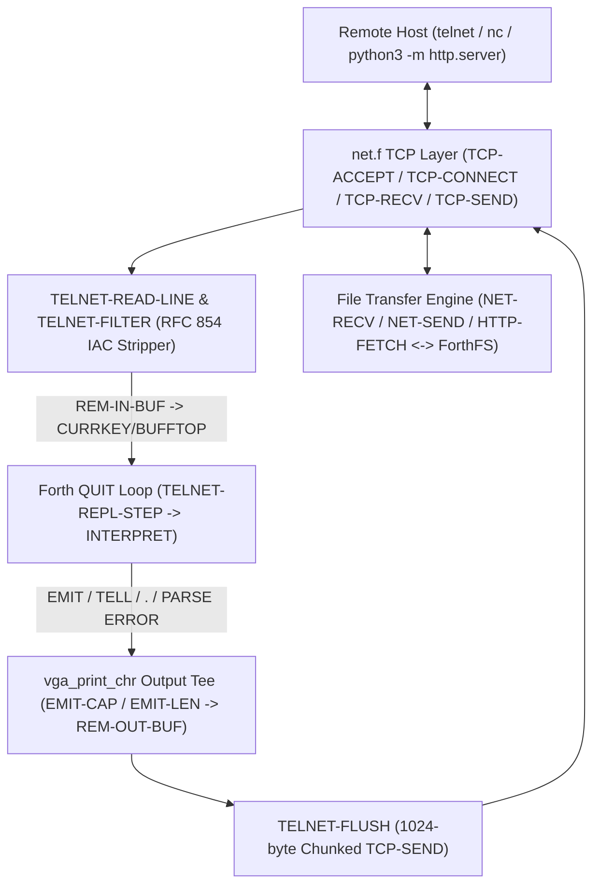

# `remote.f` — Remote Telnet Forth REPL & Network File Transfer for f64OS

[disk_files/net/remote.f](file:///home/tliston/Research/bare-metal/f64OS/disk_files/net/remote.f) is an `INCLUDE`-able remote administration and file-transfer suite built on top of [disk_files/net/net.f](file:///home/tliston/Research/bare-metal/f64OS/disk_files/net/net.f). It provides:

* **Automatic Dependency Loading (`ENSURE-NET`)** — Checks whether `/net/net.f` is already loaded and automatically chains it if not
* **Remote Telnet Forth REPL (`TELNETD`, `TBYE`)** — Full interactive Forth interpreter over TCP with RFC 854 Telnet IAC filtering, simultaneous local VGA mirroring, and path-aware `f64OS: /...> ` prompts
* **Raw TCP File Upload to ForthFS (`NET-RECV`)** — Receive files up to 512 KiB directly into any ForthFS directory using `nc` (Netcat)
* **Raw TCP File Download from ForthFS (`NET-SEND`)** — Stream files of any size sector-by-sector from ForthFS to a remote host using `nc`
* **HTTP/1.0 File Downloader (`HTTP-FETCH`)** — Fetch files from an HTTP server (such as `python3 -m http.server`), strip HTTP response headers, and write the payload directly to ForthFS
* **Clean Unloading (`REMOTE-UNLOAD`)** — Restore the local REPL hook and reclaim all dictionary and buffer memory

---

## 1. Quick Start

At the f64OS prompt, load [disk_files/net/remote.f](file:///home/tliston/Research/bare-metal/f64OS/disk_files/net/remote.f):

```forth
INCLUDE /net/remote.f
```

If `/net/net.f` has not been loaded yet, `ENSURE-NET` automatically loads `/net/net.f` (initializing the `e1000` NIC and acquiring an IPv4 lease via DHCP) and then chains `/net/remote.f`:

```text
/net/net.f not loaded; loading /net.f...
Acquiring IP via DHCP... OK
f64OS TCP/IP stack ready.
NIC MAC : 52:54:00:12:34:56 (MY-MAC)
Local IP: 192.168.122.142 (MY-IP)
Netmask : 255.255.255.0 (NET-MASK)
Gateway : 192.168.122.1 (GW-IP)
DNS Srv : 192.168.122.1 (DNS-IP)
Remote tools ready: <port> TELNETD, <port> NET-RECV <file>,
<port> NET-SEND <file>, HTTP-FETCH. Use REMOTE-UNLOAD to
unload and free allocated cells.
```

### Start a Remote Telnet REPL

On f64OS:
```forth
2323 TELNETD
```

From your Linux host or another machine on the LAN:
```bash
telnet 192.168.122.142 2323
# or:
nc 192.168.122.142 2323
```

You will immediately receive the remote Forth banner and working-directory prompt:
```text
f64OS Remote Forth REPL (type TBYE to disconnect)
f64OS: /> 
```

To end the remote session and return control to the local f64OS console, type `TBYE` in the Telnet session (or press any key on the local f64OS keyboard).

When finished with the remote utilities, unload them:
```forth
REMOTE-UNLOAD
```

---

## 2. Architecture



### 2.1 Automatic Dependency Chain (`ENSURE-NET`)
Because f64OS uses a single 32 KiB `INC-BUF` for `INCLUDE`, calling `INCLUDE /net/net.f` replaces `/net/remote.f` inside `INC-BUF`. `ENSURE-NET` solves this transparently:
1. Checks `S" TCP-ACCEPT" FIND 0=`.
2. If `/net/net.f` is already loaded, it consumes the trailing `/net/net.f` token with `WORD 2DROP` and continues compiling `remote.f`.
3. If `/net/net.f` is not loaded, it rolls back `LATEST` and `HERE` (so pass 1 leaves zero dictionary footprint), calls `INCLUDE` to load `/net/net.f` into `INC-BUF`, and appends `\nINCLUDE /net/remote.f\n` directly onto `BUFFTOP @`. Once `/net/net.f` finishes initializing, `QUIT` automatically re-includes `/net/remote.f`.

### 2.2 Kernel Console Output Capture (`EMIT-CAP` & `EMIT-LEN`)
All Forth console output in f64OS (`EMIT`, `TELL`, `."`, `.`, `CR`, `LS`, `CAT`, `PWD`, `PROMPT`, and `PARSE ERROR:`) passes through `vga_print_chr` in [kernel/vga.nasm](file:///home/tliston/Research/bare-metal/f64OS/kernel/vga.nasm#L79-L105), whereas the background status-bar task (`Task1`) writes directly to VRAM via `vga_print`.

Two kernel addresses are exposed in [kernel/f64_baremetal.nasm](file:///home/tliston/Research/bare-metal/f64OS/kernel/f64_baremetal.nasm#L1740-L1741):

| Kernel Constant | Stack Effect | Description |
| :--- | :--- | :--- |
| `EMIT-CAP` | `( -- addr )` | Variable holding the capture buffer address (`0` = disabled; non-zero = target buffer pointer) |
| `EMIT-LEN` | `( -- addr )` | Variable holding the number of bytes captured into the buffer (up to `32766` bytes) |

When `TELNETD` sets `REM-OUT-BUF EMIT-CAP !`, `vga_print_chr` mirrors every printed character into `REM-OUT-BUF` while translating LF (`0x0A`) into CRLF (`0x0D 0x0A`) for Telnet compatibility.

### 2.3 Hooking the Forth `QUIT` Loop (`TELNET-REPL-STEP`)
Rather than implementing a separate command parser, `TELNETD` hot-swaps the `REPL-STEP` execution token at `S" QUIT" FIND >DFA 16 +` with `TELNET-REPL-STEP`:
* While `CURRKEY @ < BUFFTOP @` (such as in the middle of a multi-word line or while executing an `INCLUDE` file), `TELNET-REPL-STEP` does not pause or prompt — it immediately invokes `INTERPRET`.
* When `CURRKEY @ >= BUFFTOP @`, `TELNET-REPL-STEP` prints `PROMPT`, flushes `REM-OUT-BUF` over TCP in 1024-byte segments via `TELNET-FLUSH`, reads the next command line from TCP via `TELNET-READ-LINE`, echoes the command locally on the VGA console, and points `CURRKEY` and `BUFFTOP` at `REM-IN-BUF`.

---

## 3. Complete Word Reference

### Primary User Commands

| Word | Stack / Parse Effect | Description |
| :--- | :--- | :--- |
| `TELNETD` | `( port -- )` | Listen on TCP `port` and attach the Forth REPL to the incoming Telnet/TCP client |
| `TBYE` | `( -- )` | Send a goodbye message, flush output, close the Telnet TCP connection, and restore local `REPL-STEP` |
| `NET-RECV` | `( port "filepath" -- )` | Listen on TCP `port`, receive up to 512 KiB (`XFER-MAX`) until EOF, and save to `"filepath"` |
| `NET-SEND` | `( port "filepath" -- )` | Verify `"filepath"` exists, listen on TCP `port`, stream the file sector-by-sector over TCP, and close |
| `HTTP-FETCH` | `( ip port url-addr url-len "filepath" -- )` | Perform an HTTP/1.0 `GET` to `ip:port`, strip HTTP headers, and save the response body to `"filepath"` |
| `REMOTE-UNLOAD` | `( -- )` | Disable output capture, restore local `REPL-STEP`, and free all dictionary memory allotted by `remote.f` |

---

### Internal Helpers, Buffers & Values

| Word | Stack Effect | Description |
| :--- | :--- | :--- |
| `ENSURE-NET` | `( "net-path" -- )` | Auto-load `/net/net.f` and chain `/net/remote.f` if `TCP-ACCEPT` is not yet in the dictionary |
| `TELNET-FLUSH` | `( -- )` | Transmit `EMIT-LEN @` captured bytes from `REM-OUT-BUF` over TCP in 1024-byte chunks and reset `EMIT-LEN` |
| `TELNET-FILTER` | `( b -- char \| 0 )` | Stateful RFC 854 filter that strips 2-byte, 3-byte (`WILL`/`WONT`/`DO`/`DONT`), and `SB`..`SE` IAC sequences |
| `TELNET-READ-LINE` | `( -- flag )` | Read a line of TCP input into `REM-IN-BUF`, handle backspace, echo locally, and set `CURRKEY`/`BUFFTOP` |
| `TELNET-STOP` | `( -- )` | Flush remaining output, clear `EMIT-CAP`/`EMIT-LEN`, close TCP, and restore `REPL-STEP` in `QUIT` |
| `TELNET-REPL-STEP` | `( -- )` | Replacement `QUIT` step that flushes output and refills `REM-IN-BUF` over TCP when the input buffer empties |
| `HTTP-BODY-OFFSET` | `( -- offset )` | Scan `XFER-BUF` (`XFER-LEN` bytes) for `\r\n\r\n` (`13 10 13 10`) and return the byte offset of the HTTP body |
| `REM-OUT-BUF` | `( -- addr )` | 32,768-byte output capture buffer pointed to by `EMIT-CAP` during a Telnet session |
| `REM-IN-BUF` | `( -- addr )` | 256-byte input line buffer for incoming Telnet commands |
| `XFER-MAX` | `( -- 524288 )` | Maximum file size (512 KiB) buffered in memory by `NET-RECV` and `HTTP-FETCH` |
| `XFER-BUF` | `( -- addr )` | 524,288-byte buffer used by `NET-RECV` and `HTTP-FETCH` |

---

## 4. Usage Examples & Recipes

### 4.1 Interactive Remote Session (`TELNETD`)
1. On f64OS:
   ```forth
   INCLUDE /net/remote.f
   2323 TELNETD
   ```
2. On your Linux host:
   ```bash
   telnet <f64OS-IP> 2323
   ```
3. Inside the Telnet session, all Forth words, path-based filesystem commands, colon definitions, and `INCLUDE` files work normally:
   ```text
   f64OS Remote Forth REPL (type TBYE to disconnect)
   f64OS: /> ls /work
   ..               <DIR>
   TEST.F           42 bytes
   IF1              <DIR>
   IF2              <DIR>
   ZORK1.Z5         84856 bytes
   f64OS: /> cd /work/if1
   f64OS: /WORK/IF1> pwd
   /WORK/IF1
   f64OS: /WORK/IF1> : square dup * ;
   f64OS: /WORK/IF1> 12 square .
   144 f64OS: /WORK/IF1> tbye
   Goodbye from f64OS!
   ```

### 4.2 Running a One-Liner Command Remotely via `nc`
Because `TELNET-READ-LINE` drains `TCP-RX-LEN` even after the client sends `FIN`, you can pipe single commands or scripts straight into `TELNETD` from your host:
```bash
echo "ls /work" | nc -q 1 <f64OS-IP> 2323
```

### 4.3 Pushing a File from Your Host to f64OS (`NET-RECV`)
1. On f64OS (either at the local console or inside a Telnet session):
   ```forth
   9000 NET-RECV /work/mycode.f
   ```
2. On your Linux host:
   ```bash
   nc -q 0 <f64OS-IP> 9000 < mycode.f
   ```
   f64OS receives the stream into `XFER-BUF`, reports the byte count, and writes `/work/mycode.f` to disk.

### 4.4 Pulling a File from f64OS to Your Host (`NET-SEND`)
1. On f64OS:
   ```forth
   9000 NET-SEND /work/mycode.f
   ```
2. On your Linux host:
   ```bash
   nc <f64OS-IP> 9000 > mycode.f
   ```
   f64OS streams `/work/mycode.f` directly from disk in 512-byte sectors and closes the connection upon completion.

### 4.5 Downloading Files from a Host Web Server (`HTTP-FETCH`)
1. On your Linux host (assuming IP `192.168.122.1`), start a web server in the directory containing your files:
   ```bash
   python3 -m http.server 8000
   ```
2. On f64OS:
   ```forth
   192 168 122 1 IP4 8000 S" /newgame.z5" HTTP-FETCH /work/newgame.z5
   ```
   `HTTP-FETCH` downloads `/newgame.z5`, strips the HTTP response headers, prints `Saving <N> bytes...`, and writes the file directly to `/work/newgame.z5`.
